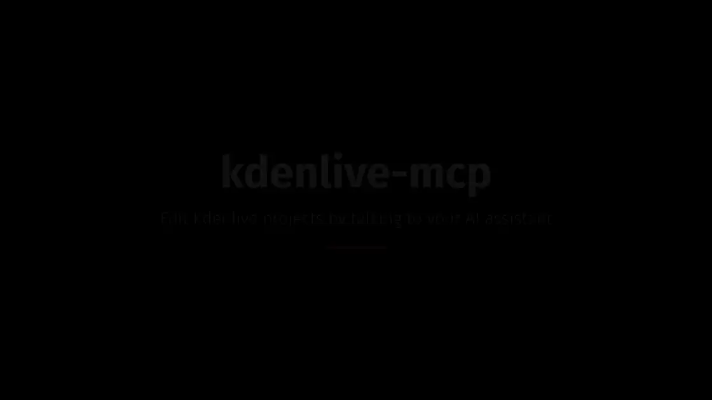

# kdenlive-mcp

<!-- mcp-name: io.github.mhbxyz/kdenlive-mcp -->

**Edit videos in [Kdenlive](https://kdenlive.org) by talking to your AI assistant.**

[](https://pypi.org/project/mcp-kdenlive/)
[](https://pypi.org/project/mcp-kdenlive/)
[](https://github.com/mhbxyz/kdenlive-mcp/blob/main/docs/compatibility.md)
[](https://github.com/mhbxyz/kdenlive-mcp/actions/workflows/ci.yml)
[](https://registry.modelcontextprotocol.io/v0/servers?search=io.github.mhbxyz/kdenlive-mcp)
[](https://github.com/mhbxyz/kdenlive-mcp/blob/main/LICENSE)

`kdenlive-mcp` is an [MCP](https://modelcontextprotocol.io) server that gives Claude, Codex,
OpenCode or any MCP client a real editing toolkit for Kdenlive: cut, arrange, crossfade, add
titles and subtitles, mix the sound, render, and check the result. Everything runs on your
machine, and what comes out is an ordinary Kdenlive project you can open and keep editing.

<p align="center">
  <a href="https://github.com/mhbxyz/kdenlive-mcp/raw/main/assets/kdenlive-mcp-demo.mp4">
    
  </a>
  <br>
  <sub><b>One prompt, one trailer, 2½ minutes.</b> Claude Code (left) cuts a 30-second trailer:
  six shots, crossfades, titles, subtitles, music, effects and guides, then renders it and checks
  the file. Kdenlive (right) opens each version as it is saved. Sped up 4×;
  <a href="https://github.com/mhbxyz/kdenlive-mcp/raw/main/assets/kdenlive-mcp-demo.mp4">full video with the rendered trailer and its sound</a> (MP4, 15 MB).</sub>
</p>

> [!IMPORTANT]
> **Linux only for now.** The server relies on Linux mechanisms (process and window checks,
> Flatpak, XDG folders). macOS and Windows are planned after 1.0
> ([#98](https://github.com/mhbxyz/kdenlive-mcp/issues/98)).

## Why kdenlive-mcp

- **Real Kdenlive projects, not a black box.** Every edit is written in Kdenlive's own format:
  open the project in Kdenlive and every clip, crossfade, title and effect is there to adjust.
  Projects are checked against a real Kdenlive round trip.
- **A full editing toolkit.** 37 tools: timeline cuts, moves, trims and splits; crossfades;
  editable titles; SRT/WebVTT subtitles; colour and fade effects; volume and audio fades;
  guides and markers; media relinking; rendering with Kdenlive's presets, in the background
  if you like.
- **Your work stays safe.** Edits go to a copy unless you ask otherwise, the original is backed
  up before it is ever replaced, and the server refuses to write over a project that is open
  in Kdenlive. It only touches the folders you allow (your Videos folder by default).
- **Renders that are checked.** The assistant does not just launch a render: the output is
  validated (streams, duration) before it is reported as done.
- **Local and private.** No account, no upload, no telemetry. The server talks to your
  assistant over stdio and runs Kdenlive, MLT and FFmpeg on your machine.
- **Works with your assistant.** Tested with Claude Code, Codex CLI, OpenCode and Grok Build
  CLI, and listed in the official MCP Registry.

## What you can ask

> *"Cut a 30-second trailer from the shots in ~/Videos/holiday, with crossfades, a title and
> the music fading out at the end. Render it in 1080p."*

> *"This project says media is missing. I moved everything to ~/Videos/archive: fix it."*

> *"Import interview.srt as subtitles, add a chapter guide at each question and lower the
> music under the voices."*

> *"Turn this edit into a vertical short for social media and render it."*

More scenarios, played by scripts and by a real assistant, are in
[examples/demos](https://github.com/mhbxyz/kdenlive-mcp/tree/main/examples/demos).

## Install

You need **Linux**, **Python 3.11+**, and Kdenlive, MLT (`melt`) and FFmpeg (`ffprobe`)
installed from your distribution (the Python package does not install them):

```sh
sudo pacman -S kdenlive mlt ffmpeg          # Arch Linux, CachyOS
sudo apt install kdenlive melt ffmpeg       # Ubuntu, Debian
```

Then install the server and check that it finds everything:

```sh
pipx install mcp-kdenlive      # NOT "kdenlive-mcp": that PyPI name is an unrelated project
kdenlive-mcp diagnose          # exit status 1 if something required is missing
```

> [!WARNING]
> The PyPI package is **`mcp-kdenlive`**. `pipx install kdenlive-mcp` installs an unrelated
> project from another author. The command installed is `kdenlive-mcp`.

<details>
<summary>Other ways to install (uv, virtual environment, from source)</summary>

```sh
uvx mcp-kdenlive --version                    # run without installing, with uv
python3 -m venv ~/.venvs/kdenlive-mcp && ~/.venvs/kdenlive-mcp/bin/pip install mcp-kdenlive
```

From source:

```sh
git clone https://github.com/mhbxyz/kdenlive-mcp.git
cd kdenlive-mcp
uv sync            # or: python -m venv .venv && .venv/bin/pip install -e .
uv run kdenlive-mcp --version
```

</details>

### Connect your assistant

Add the server to your MCP client, using the absolute path from `command -v kdenlive-mcp`:

```json
{
  "mcpServers": {
    "kdenlive": {
      "command": "/home/you/.local/bin/kdenlive-mcp",
      "env": { "KDENLIVE_MCP_ALLOWED_ROOTS": "/home/you/Videos" }
    }
  }
}
```

For Claude Code, in one line:

```sh
claude mcp add kdenlive -e KDENLIVE_MCP_ALLOWED_ROOTS="$HOME/Videos" -- "$(command -v kdenlive-mcp)"
```

Ready-made configurations for each client, a Flatpak or AppImage Kdenlive, and every
setting are in the [user guide](https://github.com/mhbxyz/kdenlive-mcp/blob/main/docs/user-guide.md)
and [client guide](https://github.com/mhbxyz/kdenlive-mcp/blob/main/docs/clients.md).

## Documentation

| | |
|---|---|
| [User guide](https://github.com/mhbxyz/kdenlive-mcp/blob/main/docs/user-guide.md) | Install, settings, working safely with Kdenlive, upgrade, troubleshooting |
| [Clients](https://github.com/mhbxyz/kdenlive-mcp/blob/main/docs/clients.md) | Tested assistants and copyable configurations |
| [Tools](https://github.com/mhbxyz/kdenlive-mcp/blob/main/docs/tools.md) | Every tool, its parameters and its limits |
| [Compatibility](https://github.com/mhbxyz/kdenlive-mcp/blob/main/docs/compatibility.md) | Supported Kdenlive, MLT, FFmpeg, Python and Linux versions |
| [Security model](https://github.com/mhbxyz/kdenlive-mcp/blob/main/docs/security.md) | Allowed folders, process isolation, what the server never does |
| [Demos](https://github.com/mhbxyz/kdenlive-mcp/tree/main/examples/demos) | End-to-end scenarios and results with a real assistant |
| [Changelog](https://github.com/mhbxyz/kdenlive-mcp/blob/main/CHANGELOG.md) | What changed in each version, with migration notes |
| [Roadmap](https://github.com/mhbxyz/kdenlive-mcp/issues/1) | What is planned, up to 1.0 and after |
| [Contributing](https://github.com/mhbxyz/kdenlive-mcp/blob/main/CONTRIBUTING.md) | Development setup, tests, conventions |
| [Security policy](https://github.com/mhbxyz/kdenlive-mcp/blob/main/SECURITY.md) | How to report a vulnerability |

Maintainers: [releasing](https://github.com/mhbxyz/kdenlive-mcp/blob/main/docs/releasing.md),
[packaging](https://github.com/mhbxyz/kdenlive-mcp/blob/main/docs/packaging.md),
[MCP Registry](https://github.com/mhbxyz/kdenlive-mcp/blob/main/docs/registry.md),
[versioning](https://github.com/mhbxyz/kdenlive-mcp/blob/main/docs/versioning.md),
[incident response](https://github.com/mhbxyz/kdenlive-mcp/blob/main/docs/incident-response.md),
[architecture](https://github.com/mhbxyz/kdenlive-mcp/blob/main/docs/architecture.md),
[research](https://github.com/mhbxyz/kdenlive-mcp/blob/main/docs/research/integration-surfaces.md).

## License and credits

MIT. Kdenlive is a [KDE](https://kde.org) project; kdenlive-mcp is an independent project, not
affiliated with KDE.

The demo uses footage and music from *Big Buck Bunny*, © 2008 Blender Foundation,
[peach.blender.org](https://peach.blender.org), licensed under
[CC BY 3.0](https://creativecommons.org/licenses/by/3.0/).
